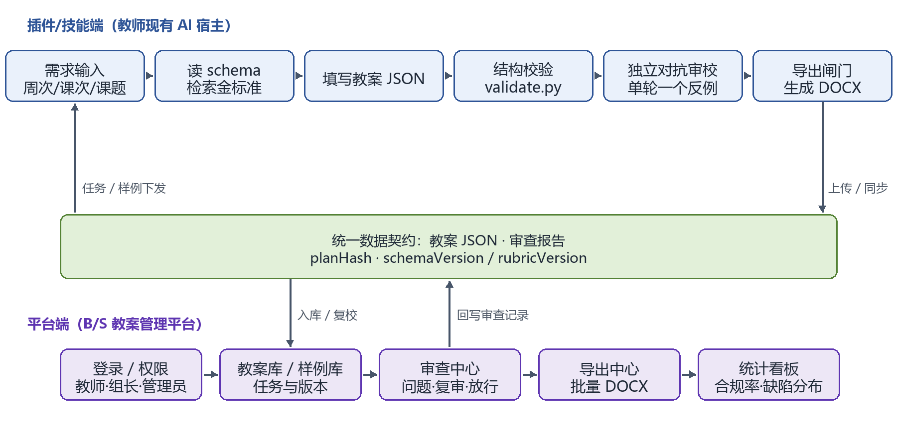
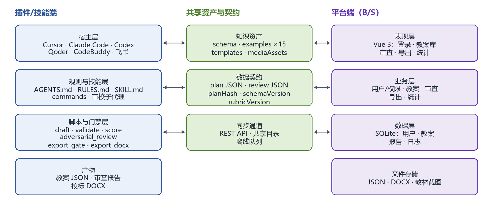

毕业设计（论文）开题报告

题目：面向中职信息技术的校标教案双端生成平台设计与实现

（英文）：Design and Implementation of a Dual-End Lesson Plan Generation Platform for Secondary Vocational Information Technology

学院：____________________

专业：____________________

姓名：____________________

学号：____________________

指导教师：____________________

日期：2026 年 11 月

---
# 面向中职信息技术的校标教案双端生成平台设计与实现

## 1 选题背景与研究意义

### 1.1 研究背景

教育信息化 2.0 行动计划提出推动信息技术与教育教学深度融合，从融合应用走向创新发展[1]；2025 年教育部等九部门《关于加快推进教育数字化的意见》进一步提出促进人工智能助力教育变革，把人工智能技术融入教育教学全要素全过程[2]。新修订的职业教育法明确职业教育与普通教育同等重要，强调产教融合与数字化支撑[3]；中等职业学校信息技术课程标准则以信息意识、计算思维、数字化学习与创新、信息社会责任为核心素养[4]。落到课堂，这些要求最直接的载体就是教案。

东莞经贸学校信息技术课程在阶段任务上以一级考证辅导为主线，教案须按校标（学校统一的教案格式）填写元信息、三维目标、重点难点、教法资源与八步流程，八步依次为复习与导入、明确学习目标、知识学习、工作任务实施、课程考核、课堂小结、布置作业、教学反思。固定格式保证了教学环节齐全，也带来两个现实问题：教师每节课都要重复填写与排版；新任教师和外聘教师难以一次写全。以一级考证辅导为例，同一课题在不同班级要重复准备；从现行模板与备课组检查方式看，格式检查多靠互相翻看，既耗时又难统一。

现有做法大致有两类。一类是通用 AI 写作工具或 Agent 技能，教师在对话里生成教案，灵活但缺少集中管理；另一类是 B/S 教学平台，能集中管理资源与记录，却要求教师离开熟悉的写作环境、登录网页操作。前者难以为教研组提供审查、统计与责任记录，后者难以嵌入教师已有的 AI 工具链。与此同时，大语言模型（Large Language Model, LLM）能在数秒内写出结构完整、语气接近教案的文本，却带来三类风险：格式漂移，字段缺失、八步不全；教学闭环断裂，目标、活动、任务、考核、反思缺少可验证的对应；过程不可追溯，改了几版、谁确认过、依据是什么难以还原。

本课题因此把系统分成双端：插件/技能端在教师已有的 Agent 宿主中完成起草、结构校验、对抗审校与 Word 导出；平台端负责教案库、样例库、审查记录、导出中心与统计；两端以统一的教案 JSON、审查报告与哈希/版本号为契约，离线可用、联网同步。平台不是替教师写教案，而是把教案写作变成一条有证据的质量流程。

### 1.2 研究意义

实践上，双端分工让教师不必离开熟悉的写作环境，又能让教研组集中查看教案、审查记录与统计结果；格式返工与排版时间预期可减少，具体效果拟在 2027 年春季学期验证。工程上，它为大模型生成教学文档提供一种可复用的双端范式：插件端负责生成与本地门禁，平台端负责管理与审计，两端用数据契约解耦，可按同一结构迁移到其他课程。管理上，教案库、审查报告与放行记录可以作为教学检查、集体备课与持续改进的依据。

## 2 国内外研究现状

### 2.1 中职信息技术教学与相关平台研究

中职信息技术课程标准把核心素养落在信息意识、计算思维、数字化学习与创新、信息社会责任四个方面，强调理实一体、做中学[4]。校标教案则把课程要求转成固定栏目与八步流程，是学校层面的落地格式。与本题同属教学支撑平台研究的，还有两篇参考论文：它们分别围绕正面唇形重建与视觉声源定位建设人工智能课程实验平台，采用 B/S 架构把算法过程可视化，解决“实验看不见”的问题[5,6]。它们的目标是让学生看懂算法，本课题的目标是让教师写出合规、可验收的教案；两者都在把前沿技术转成教学支撑，但落点不同，一个在实验观察，一个在教学设计文档。它们的 B/S 架构与权限设计，对本课题平台端仍有参考价值。

### 2.2 智能备课与教案自动生成

围绕教案生成，已有研究大致有三条路线。其一是知识增强：Zheng 等提出知识增强的大语言模型框架，用外部知识改善自动教案生成的质量[7]。其二是多角色协作：Zeng 等提出 COMA 框架，把教案生成拆给多个角色协作完成[8]。其三是教师使用研究：Lee 与 Zhai 考察职前教师使用 ChatGPT 设计科学课教案的过程与表现[9]。这些工作说明大模型可以承担相当一部分起草任务，但评价多集中在内容质量与使用体验，对校本格式是否合规、教学环节是否相互支撑、修改是否可追溯讨论较少。教学设计理论提供了另一条线索：TPACK 强调学科内容、教学法与技术的交互知识[10]，逆向设计主张先确定预期结果与证据、再安排活动[11]。这提示教案生成不能只追求文字通顺，还要让目标、证据与活动形成可检查的对应关系。

### 2.3 生成式人工智能的教育风险与治理

Kasneci 等系统梳理了大模型在教育中的机会与挑战，包括事实性错误、偏见、公平与学术诚信[12]。联合国教科文组织的生成式人工智能教育指南主张以人为中心，强调教师能力、治理与监督[13]。在国内，教育数字化政策同样强调人工智能安全保障与规范应用[2]，这与课堂层面的可追溯要求是一致的。对本题的启示是：风险不能只靠把提示词写严来解决，需要外部可执行的检查、明确的责任主体与可追溯的记录；教师不应被系统替代，而应拥有否决与放行的权力。

### 2.4 Agent 工程化与工具协议

Agent Skills（智能体技能）把指令、脚本与资源封装为可按需加载的文件夹[14]，使教案能力可以像代码一样版本化、安装与复用；模型上下文协议（Model Context Protocol, MCP）用标准接口把模型连接到外部工具与数据[15]，让校验、审查、导出等确定性操作可以被稳定调用。这两项技术为“文件型插件加本地脚本”的形态提供了依据：不必自建服务端，也能把生成流程约束在可检查的工具链里。但插件形态缺少集中管理、跨教师统计与统一权限，这正是平台端要补的部分。

### 2.5 研究述评

综合来看，已有工作存在三点不足：一是单端思维，插件只解决生成、平台只解决管理，缺少两端协同；二是校本格式约束弱，模型输出与学校模板之间仍靠人工对齐；三是教学闭环缺少可执行的审查机制，目标、活动、考核是否一致多依赖经验判断。总体上看，国外研究偏重生成质量与多角色协作，国内实践更关注课程平台与校本规范，两者尚未汇合到“生成即验收”的流程上。由此，本课题把双端分工、结构可机检、审查可追溯作为切入点。

## 3 研究目标与研究内容

### 3.1 研究目标

（1）建成插件/技能端：在 5 类宿主与飞书工作空间中完成校标教案的起草、结构校验、对抗审校、导出闸门与 Word 导出。

（2）建成平台端：一个轻量 B/S 教案管理平台，提供教案库、样例库、审查中心、导出中心、统计与角色权限。

（3）打通双端协同：以统一数据契约实现离线生成、联网同步、哈希校验与冲突处理，并在真实备课任务中评估结构合规、教学闭环、效率与可用性。

### 3.2 研究内容

（1）校标知识建模与共享资产。梳理 17 个必填字段、三维目标、八步流程与“必须完成/必做”要求；字段之间设置约束，如周次与课次为正整数、学期只能为 1 或 2、计划学时必须为正数。为需要分栏呈现的环节设计结构化活动，包含主要内容、教师活动、学生活动、分钟数与可核验产出；以通过校验的 7 份信息技术校标教案为金标准，补充 C 语言程序设计 8 份样例，形成共享样例库与媒体资产目录。

（2）插件/技能端。按常驻规则、技能、命令、审校子代理、hooks、MCP 与宿主清单组织；hooks 在会话开始、写回与结束时触发，审校子代理独立于撰写者。实现字段与八步齐全（教学反思可留空）、任务可执行性检查，单轮一个最强反例的对抗审查，哈希绑定与教师实名放行，以及不依赖 python-docx/pandoc 的校标 DOCX 导出。

（3）平台端。采用前后端分离的 B/S 架构：前端负责登录、任务、教案库、审查中心、导出中心与统计看板；后端提供用户与角色、教案与审查记录、样例与资产、导出任务、统计接口；数据库保存结构化元数据与版本，文件存储保存教案 JSON、审查报告与 DOCX。权限分为教师、教研组长与管理员三类。

（4）双端协同。定义统一数据契约：教案 JSON、审查报告、`schemaVersion`、`rubricVersion` 与 `planHash`；提供 REST 接口与共享目录两种同步方式；插件端离线可用，联网后上传或拉取；平台端入库前复校哈希与版本，哈希不匹配则拒绝覆盖并保留审计记录。

（5）评价与迭代。从结构、闭环、双端一致性、平台可用性与效率五个方面设计指标，在东莞经贸学校信息技术课程中开展小范围应用，按“设计—实现—演示—评价”迭代。

### 3.3 拟解决的关键问题

RQ1：校标教案的隐性规范如何转成字段、规则与门禁，既不漏检，又不过度限制教学设计？

RQ2：双端职责如何划分，统一契约如何保证教案、审查报告与版本在离线、联网两种状态下一致？

RQ3：双端形态在真实备课与多宿主环境中的合规性、效率与可用性如何？

## 4 研究方法与技术路线

### 4.1 研究方法

（1）文献研究法：梳理教育数字化政策、中职课标、教案生成、Agent 工程与 B/S 平台研究，确定问题边界。

（2）案例与样例分析法：对 7 份信息技术金标准、8 份 C 语言样例与两篇平台论文做结构对照，提炼共性与差异。

（3）设计科学研究：按问题、设计、实现、演示、评价的顺序迭代，每轮以真实教案任务检验双端设计。

（4）原型法与工程测试：为校验、审查、门禁、接口与导出编写单元测试与端到端用例，保证行为可复现。

（5）专家评审与准实验：邀请计算机教研组按量规评分；在同一课题上比较人工撰写与双端生成的时间与质量；平台端辅以系统可用性量表（SUS）问卷。

### 4.2 双端技术路线

插件/技能端的主流程为：教师给出周次、课次与课题，系统读取字段表，检索最接近的金标准，填写教案 JSON，执行结构校验，再由独立审校构造教学闭环反例；若出现 blocker 或 major，则修复并复审，或由教师实名放行；通过导出闸门后生成校标 DOCX。平台端的主流程为：教师登录后选择任务与样例，接收插件端上传的教案与审查报告，入库前复校哈希与版本，在审查中心查看问题、复审与放行记录，在导出中心批量导出，在统计看板查看合规率与缺陷分布。两端通过统一契约与同步接口衔接，如图 1 所示。

这条路线有三个关键点：第一，结构校验是确定性的，同一脚本在已安装 Python 的宿主上给出同一结论，宿主能力差异见 5.2；第二，审查报告记录教案哈希、轮次、问题级别与处理状态，教案一改，旧报告即失效；第三，平台端不重复实现生成算法，只做入库校验、管理、审计与统计，避免两端逻辑分叉。

### 4.3 双端总体架构

系统分为三部分（如图 2）：左侧是插件/技能端，包含宿主层、规则与技能层、脚本与门禁层；中间是共享资产与契约层，存放 schema、样例、模板以及教案 JSON、审查报告与哈希/版本；右侧是平台端，包含表现层、业务层、数据层与文件存储。插件端可以完全离线运行，平台端负责跨教师的管理与统计；两端通过 REST 接口或共享目录同步，不共享数据库，降低耦合。双端功能划分见表 1。

现有插件/技能端已具备三技能、五份宿主清单、八个 MCP 工具与十三个测试模块，平台端为本课题拟建设部分，具体基础见表 1。

表 1 双端功能划分

| 能力 | 插件/技能端 | 平台端 |
|---|---|---|
| 教案生成 | 在宿主中起草、检索样例、填写 JSON | 下发任务、选择样例、查看草稿 |
| 结构校验 | 本地 `validate.py`，退出码判定 | 入库前复校并记录结果 |
| 对抗审查 | 独立审校、哈希绑定报告 | 展示问题、复审与放行记录 |
| Word 导出 | 本地 `export_docx.py` | 导出中心批量导出与模板管理 |
| 知识资产 | 读取 schema 与 examples | 维护样例库、教材截图与版本 |
| 管理与统计 | 无 | 教案库、角色权限、合规率与缺陷统计 |
| 运行环境 | Cursor、Claude Code、Codex、Qoder、CodeBuddy、飞书 | 浏览器，B/S 部署 |

### 4.4 评价设计

评价从九个指标展开（见表 2）：结构合规率、金标准贴近分、闭环缺陷密度、证据链完整率、双端数据一致率、平台任务完成率、专家评分、单份耗时与平台可用性。数据来自校验输出、审查报告、平台日志、教研组评分表、计时记录与 SUS 问卷。开题阶段只给出预期目标，实测数据在 2027 年春季学期教学应用后汇总。其中结构合规率、闭环缺陷密度与证据链完整率是硬指标，专家评分、耗时与可用性是软指标，两类分开报告。

表 2 评价指标与预期目标

| 指标 | 操作化定义 | 数据来源 | 预期目标 |
|---|---|---|---|
| 结构合规率 | 通过结构校验的教案数占提交教案数的比例 | `validate` 输出 | ≥95% |
| 金标准贴近分 | 0–100 结构分及最接近样例 | `score` 输出 | 均分≥85 |
| 闭环缺陷密度 | 每份教案未关闭的 blocker 与 major 数 | 审查报告 | ≤0.5 |
| 证据链完整率 | 哈希匹配、复审与放行记录齐全的教案数占比 | 审查报告与平台 | 100% |
| 双端数据一致率 | 插件端与平台端教案、报告、哈希一致的记录占比 | 同步日志 | ≥98% |
| 平台任务完成率 | 教师独立完成“建课—上传—审查—导出”的比例 | 平台日志与观察 | ≥90% |
| 专家评分 | 目标、活动、任务、考核、反思五维五级评分 | 教研组评分表 | 均分≥4.0/5 |
| 单份耗时 | 从需求确认到 DOCX 完成的分钟数 | 计时记录 | 较人工下降≥30%（探索） |
| 平台可用性 | SUS 量表得分 | 教师问卷 | ≥70 |

## 5 创新点与难点

### 5.1 创新点

（1）双端分工。插件/技能端负责生成与本地门禁，平台端负责管理、审计与统计，两端以统一契约衔接；与“只做插件”或“只做网页平台”相比，教师不离开写作环境，教研组又能集中管理。

（2）结构—门禁与对抗审查。把校标教案变成可机检字段与导出闸门，审校每轮只提交一个最能推翻教学闭环的反例；报告与教案哈希绑定，教师实名放行，复审留痕。

（3）文件型多宿主加统一契约。同一技能目录跨 5 类宿主与飞书复用，平台端不重复实现生成逻辑；离线可用、联网同步，便于校本迭代与 Git 管理。

### 5.2 难点与对策

（1）双端数据一致性。离线修改、重复上传与并发编辑都可能造成版本冲突。对策是统一契约，以 `planHash`、`schemaVersion` 与 `rubricVersion` 做幂等校验；平台端拒绝哈希不匹配的覆盖，保留审计记录。

（2）平台权限与隐私。教案、班级与学生信息需要分级可见。对策是教师、教研组长、管理员三角色 RBAC，默认本地部署，导出与统计做脱敏。

（3）教学闭环的可判定性。目标是否被活动支撑、考核能否证明目标，本质上是专业判断。对策是把可观察证据作为反例触发条件，最终判断留给教师。

（4）双端开发工作量。对策是先做 MVP：平台端只做登录、教案库、审查中心、导出中心与统计五块，复用插件端脚本与数据契约，避免重复开发。

## 6 可行性分析

### 6.1 工作基础

插件/技能端已有可用原型：三技能、五份宿主清单、八个 MCP 工具、十三个测试模块（91 个用例），代码约 4400 行；具备 7 份信息技术金标准与 8 份 C 语言样例；实现了结构校验、结构评分、对抗审查、教师放行、导出闸门与 DOCX 导出。平台端为本课题新增部分，数据契约、功能清单与页面流程已在开题阶段确定，可按 MVP 逐步实现。

### 6.2 技术与数据条件

插件端以 Python 标准库为主，不需要 GPU；平台端拟采用 Python Web 框架与 SQLite，前端采用 Vue 3 与组件库，部署在学校机房或教研组电脑；Word 版式可用 LibreOffice 渲染检查。数据方面，校标样例、教材截图、机房与教研组均可获得；教学应用拟在 2027 年春季学期进行。

### 6.3 风险与应对

双端范围膨胀、宿主差异、样本量小与教师接受度是主要风险。对应措施是：以 MVP 锁定平台端五块功能，不追求大而全；以技能内脚本保证核心流程不依赖 hooks；以专家评审与小样本描述统计控制结论强度；先用教研组试点，再逐步推广。

## 7 进度安排

研究进度按八个月安排，具体见表 3。

表 3 研究进度安排

| 时间 | 阶段任务 | 主要产出 |
|---|---|---|
| 2026.11 | 文献调研与双端需求分析 | 开题报告、双端需求清单 |
| 2026.12 | 统一契约与 schema、量规定稿 | 数据契约、字段表、审查量规 v1 |
| 2027.01 | 插件端完善与样例复核 | 校验/审查/导出脚本、新增 4–6 份样例 |
| 2027.02 | 平台端后端与数据库 | 用户、教案、审查、导出接口 |
| 2027.03 | 平台端前端与双端联调 | 教案库、审查中心、导出中心、同步日志 |
| 2027.04 | 教学应用与评价 | 评分表、计时、SUS 与一致性数据 |
| 2027.05 | 数据整理与论文撰写 | 毕业论文初稿与定稿 |
| 2027.06 | 答辩准备 | 演示材料与修订说明 |

## 8 预期成果

（1）可安装的插件/技能端：三技能、五份宿主清单、八个 MCP 工具与配套脚本。

（2）可运行的平台端：登录与权限、教案库、样例库、审查中心、导出中心与统计看板。

（3）共享资产：字段规范、八步流程、十五份样例教案（7 份信息技术、8 份 C 语言）、数据契约与媒体资产。

（4）评价报告：结构合规、闭环缺陷、双端一致性、平台任务完成率、专家评分、耗时与 SUS 的实测结果。

（5）毕业论文一篇、答辩演示材料与教研组使用说明。

## 参考文献

[1] 教育部. 教育信息化2.0行动计划[EB/OL]. (2018-04-13)[2026-10-25]. http://www.moe.gov.cn/srcsite/A16/s3342/201804/t20180425_334188.html.
[2] 教育部, 中央网信办, 国家发展改革委, 等. 关于加快推进教育数字化的意见[EB/OL]. (2025-04-11)[2026-10-25]. http://www.moe.gov.cn/srcsite/A01/s7048/202504/t20250416_1187476.html.
[3] 全国人民代表大会常务委员会. 中华人民共和国职业教育法[Z]. 2022-04-20.
[4] 教育部. 中等职业学校信息技术课程标准: 2020年版[S]. 北京: 高等教育出版社, 2020.
[5] 高文晴. 人工智能课程中正面唇形重建平台的设计与实验[D]. 广州: 广东技术师范大学, 2026.
[6] 叶可均. 人工智能课程中的复杂场景视觉声源定位实验平台的设计与实现[D]. 广州: 广东技术师范大学, 2026.
[7] ZHENG Y, HUANG S, ZENG X, et al. Knowledge-enhanced large language models for automatic lesson plan generation[J]. Humanities and Social Sciences Communications, 2025, 12(1): 1784.
[8] ZENG X, ZHENG Y, HUANG S, et al. COMA: a collaborative multi-role agent framework for automated lesson plan generation[C]//Proceedings of the ACM Web Conference 2026. New York: ACM, 2026: 9745-9756.
[9] LEE G G, ZHAI X. Using ChatGPT for science learning: a study on pre-service teachers' lesson planning[J]. IEEE Transactions on Learning Technologies, 2024, 17: 1643-1660.
[10] MISHRA P, KOEHLER M J. Technological pedagogical content knowledge: a framework for teacher knowledge[J]. Teachers College Record, 2006, 108(6): 1017-1054.
[11] WIGGINS G, MCTIGHE J. Understanding by design[M]. 2nd ed. Alexandria: ASCD, 2005.
[12] KASNECI E, SESSLER K, KÜCHEMANN S, et al. ChatGPT for good? On opportunities and challenges of large language models for education[J]. Learning and Individual Differences, 2023, 103: 102274.
[13] UNESCO. Guidance for generative AI in education and research[R]. Paris: UNESCO, 2023.
[14] ANTHROPIC. Equipping agents for the real world with Agent Skills[EB/OL]. (2025)[2026-10-25]. https://www.anthropic.com/engineering/equipping-agents-for-the-real-world-with-agent-skills.
[15] Model Context Protocol. Specification[EB/OL]. [2026-10-25]. https://modelcontextprotocol.io/specification.

## 附录

### 指导教师意见

（此处由指导教师填写）

签名：____________________　　日期：________年____月____日

### 教研室（专业）意见

（此处由教研室填写）

签名：____________________　　日期：________年____月____日

