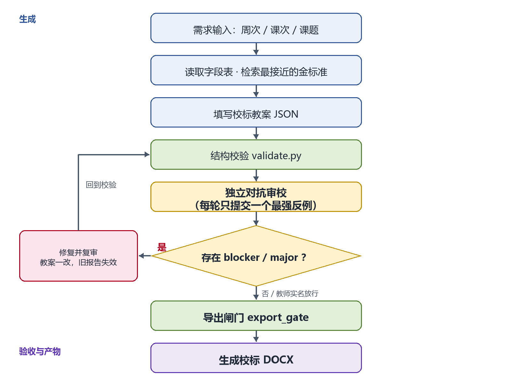
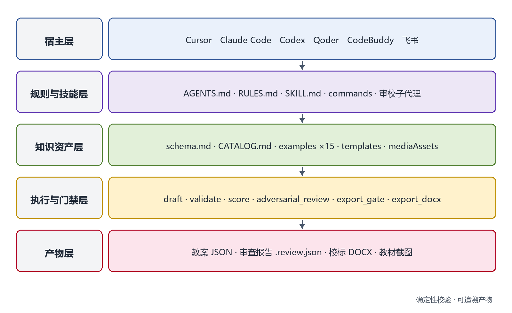

本科毕业设计（论文）开题报告

题目：面向中职信息技术的校标教案生成平台设计与实现

英文题目：Design and Implementation of a School-Standard-Aligned Lesson Plan Generation Platform for Information Technology in Secondary Vocational Schools

学院：____________________

专业：____________________

姓名：____________________

学号：____________________

指导教师：____________________

日期：2026 年 11 月

---
# 面向中职信息技术的校标教案生成平台设计与实现

## 一、选题背景与研究意义

### 1.1 研究背景

教育信息化 2.0 行动计划提出推动信息技术与教育教学深度融合，从融合应用走向创新发展[1]；2025 年教育部等九部门《关于加快推进教育数字化的意见》进一步提出促进人工智能助力教育变革，把人工智能技术融入教育教学全要素全过程[2]。新修订的职业教育法明确职业教育与普通教育同等重要，强调产教融合与数字化支撑[3]；中等职业学校信息技术课程标准则以信息意识、计算思维、数字化学习与创新、信息社会责任为核心素养[4]。落到课堂，这些要求最直接的载体就是教案。

东莞经贸学校信息技术课程在阶段任务上以一级考证辅导为主线，教案须按校标（学校统一的教案格式）填写元信息、三维目标、重点难点、教法资源与八步流程，八步依次为复习与导入、明确学习目标、知识学习、工作任务实施、课程考核、课堂小结、布置作业、教学反思。固定格式保证了教学环节齐全，也带来两个现实问题：教师每节课都要重复填写与排版；新任教师和外聘教师难以一次写全。以一级考证辅导为例，同一课题在不同班级要重复准备；从现行模板与备课组检查方式看，格式检查多靠互相翻看，既耗时又难统一。学校把“必须完成/必做”写入模板，本意是让任务可执行，但仅靠人工检查，仍会出现目标与活动脱节、任务缺少可核验产出、考核只给分值等现象。后果是直接的：任务没有产出，教师难以判断学生是否完成；考核没有证据，成绩解释就只能靠印象。

大语言模型（Large Language Model, LLM）能在数秒内写出结构完整、语气接近教案的文本，降低了起草门槛，同时带来三类风险。一是格式漂移：字段缺失、八步不全、周次课次与课题对不上。二是教学闭环断裂：目标、活动、任务、考核、反思之间缺少可验证的对应关系。三是过程不可追溯：改了几版、谁确认过、依据是什么，难以还原。提示词可以缓解这些问题，却不能替代可执行的检查。

本课题因此把“校标规范”从教师记忆转成机器可检查的结构与导出闸门，把“生成”与“验收”分开：模型负责起草，脚本负责结构校验，独立审校负责构造教学闭环反例，教师负责最终判断与实名放行。平台不是替教师写教案，而是把教案写作变成一条有证据的质量流程。

### 1.2 研究意义

实践上，平台预期可减少格式返工与排版时间，让教师把精力放回学情分析与活动设计，具体效果拟在 2027 年春季学期验证；对教研组，审查报告与复审记录可以作为集体备课、教学检查的依据。工程上，它为大模型生成教学文档提供一种可复用的范式，即确定性校验、反例审查与哈希门禁相结合，不绑定某个模型或云平台，可按同一结构迁移到其他课程。推广上，技能目录与脚本可随 Git 版本管理，在 Cursor、Claude Code、Codex、Qoder、CodeBuddy 与飞书工作空间复用，降低校本工具的部署与维护成本。

## 二、国内外研究现状

### 2.1 中职信息技术教学与相关平台研究

中职信息技术课程标准把核心素养落在信息意识、计算思维、数字化学习与创新、信息社会责任四个方面，强调理实一体、做中学[4]。校标教案则把课程要求转成固定栏目与八步流程，是学校层面的落地格式。与本题同属教学支撑平台研究的，还有两篇参考论文：它们分别围绕正面唇形重建与视觉声源定位建设人工智能课程实验平台，采用 B/S 架构把算法过程可视化，解决“实验看不见”的问题[5,6]。它们的目标是让学生看懂算法，本课题的目标是让教师写出合规、可验收的教案；两者都在把前沿技术转成教学支撑，但落点不同，一个在实验观察，一个在教学设计文档。

### 2.2 智能备课与教案自动生成

围绕教案生成，已有研究大致有三条路线。其一是知识增强：Zheng 等提出知识增强的大语言模型框架，用外部知识改善自动教案生成的质量[7]。其二是多角色协作：Zeng 等提出 COMA 框架，把教案生成拆给多个角色协作完成[8]。其三是教师使用研究：Lee 与 Zhai 考察职前教师使用 ChatGPT 设计科学课教案的过程与表现[9]。这些工作说明大模型可以承担相当一部分起草任务，但评价多集中在内容质量与使用体验，对校本格式是否合规、教学环节是否相互支撑、修改是否可追溯讨论较少。尤其是中职校标这类由学校层面规定的格式，既不同于国家课标，也不是通用模板，难以直接套用现有生成框架。教学设计理论提供了另一条线索：TPACK 强调学科内容、教学法与技术的交互知识[10]，逆向设计主张先确定预期结果与证据、再安排活动[11]。这提示教案生成不能只追求文字通顺，还要让目标、证据与活动形成可检查的对应关系。

### 2.3 生成式人工智能的教育风险与治理

Kasneci 等系统梳理了大模型在教育中的机会与挑战，包括事实性错误、偏见、公平与学术诚信[12]。联合国教科文组织的生成式人工智能教育指南主张以人为中心，强调教师能力、治理与监督[13]。在国内，教育数字化政策同样强调人工智能安全保障与规范应用[2]，这与课堂层面的可追溯要求是一致的。对本题的启示是：风险不能只靠把提示词写严来解决，需要外部可执行的检查、明确的责任主体与可追溯的记录；教师不应被系统替代，而应拥有否决与放行的权力。

### 2.4 Agent 工程化与工具协议

Agent Skills（智能体技能）把指令、脚本与资源封装为可按需加载的文件夹[14]，使教案能力可以像代码一样版本化、安装与复用；模型上下文协议（Model Context Protocol, MCP）用标准接口把模型连接到外部工具与数据[15]，让校验、审查、导出等确定性操作可以被稳定调用。这两项技术为“文件型插件加本地脚本”的形态提供了依据：不必自建服务端，也能把生成流程约束在可检查的工具链里。

### 2.5 研究述评

综合来看，已有工作存在三点不足：生成能力增强，但校本格式约束弱，模型输出与学校模板之间仍靠人工对齐；教学闭环缺少可执行的审查机制，目标、活动、考核是否一致多依赖经验判断；平台多走 B/S 服务端路线，与教师日常使用的写作工具链分离。总体上看，国外研究偏重生成质量与多角色协作，国内实践更关注课程平台与校本规范，两者尚未汇合到“生成即验收”的流程上。由此，本课题把结构可机检、审查可追溯、形态可嵌入作为切入点。

## 三、研究目标与研究内容

### 3.1 研究目标

（1）建立可机检的校标教案结构规范与金标准库，使结构是否合规可以由脚本判定，而不是靠感觉。

（2）实现生成、校验、对抗审校、修复或放行、导出的可追溯流水线与导出闸门，使每一次导出都有结构结论与审查证据。

（3）在真实备课任务中评估结构合规、教学闭环质量、效率与跨宿主一致性，形成可复用的校本实施方案。

### 3.2 研究内容

（1）校标教案知识建模。梳理 17 个必填字段、三维目标、八步流程与“必须完成/必做”要求；字段之间还要有约束，例如周次与课次为正整数、学期只能为 1 或 2、计划学时必须为正数。为需要分栏呈现的环节设计结构化活动，包含主要内容、教师活动、学生活动、分钟数与可核验产出；为教材截图设计媒体资产挂接方式。

（2）金标准库与样例检索。以通过校验的 7 份信息技术校标教案为金标准，补充 C 语言程序设计 8 份样例，形成按周次、课次、课题检索的样例目录；样例本身必须通过结构校验，避免拿错样例带偏结构。

（3）分层 Agent 插件。按常驻规则、技能、命令、审校子代理、hooks、MCP 与宿主清单组织；hooks 在会话开始、写回与结束时触发，审校子代理独立于撰写者。同一技能目录可在 5 类宿主与飞书工作空间复用，降低对单一平台的依赖。

（4）确定性校验与结构评分。实现字段、类型、八步齐全（教学反思可留空）与任务可执行性等检查；给出 0–100 结构分与最接近金标准，作为教师自查与教研组抽检的量化参考。

（5）对抗性审查与校标 Word 导出。独立审校每轮只提交一个最强反例；报告与教案内容哈希绑定，教案修改后旧报告自动失效；教师放行须实名并写明理由；导出前同时检查结构与审查结论，最后生成符合校标版式的 DOCX。审查报告保留轮次、问题编号、修复历史与放行记录，形成一条可以复核的证据链。

### 3.3 拟解决的关键问题

RQ1：校标教案的隐性规范如何转成字段、规则与门禁，既不漏检，又不过度限制教学设计？

RQ2：如何让生成与验收分离，使审查证据不能被旧版本复用、责任可以落到具体教师？

RQ3：文件型插件在真实备课与多宿主环境中能否稳定合规运行？

## 四、研究方法与技术路线

### 4.1 研究方法

（1）文献研究法：梳理教育数字化政策、中职课标、教案生成与 Agent 工程研究，确定问题边界。

（2）案例与样例分析法：对 7 份信息技术金标准、8 份 C 语言样例与两篇平台论文做结构对照，提炼共性与差异。

（3）设计科学研究：按问题、设计、实现、演示、评价的顺序迭代，每轮以真实教案任务检验设计。

（4）原型法与工程测试：为校验、门禁、导出编写单元测试与端到端用例，保证脚本行为可复现。

（5）专家评审与准实验：邀请计算机教研组按量规评分；在同一课题上比较人工撰写与平台生成的时间与质量，样本以描述统计为主。

### 4.2 技术路线

平台的主流程为：教师给出周次、课次与课题，系统读取字段表，检索最接近的金标准，填写教案 JSON，执行结构校验，再由独立审校构造教学闭环反例；若出现 blocker 或 major，则修复并复审，或由教师实名放行；通过导出闸门后生成校标 DOCX。如图 1 所示。这条路线有三个关键点：结构校验是确定性的，同一脚本在已安装 Python 的宿主上给出同一结论，宿主能力差异见 5.2；审查报告记录教案哈希、轮次、问题级别与处理状态，教案一改，旧报告即失效；导出不是点一下按钮，而是要先过闸门，避免带错导出。不直接把模型输出转成 Word，是因为文本一旦进入排版，字段缺失与八步不全就会被样式掩盖，检查成本更高。

### 4.3 平台架构

平台分为五层（如图 2）：宿主层（承载 Agent 的软件环境）负责对话与文件操作；规则与技能层提供常驻约束、技能流程、命令与审校角色；知识资产层存放字段表、样例目录、金标准与模板；执行与门禁层由草稿、校验、评分、审查、导出等脚本组成；产物层输出教案 JSON、审查报告、DOCX 与教材截图。各层之间通过文件与标准输入输出交互，不依赖数据库或常驻服务。

现有原型已具备三技能、五份宿主清单、八个 MCP 工具与十三个测试模块，具体基础见表 1。

表 1 现有原型基础

| 模块 | 主要文件 | 现状 |
|---|---|---|
| 教案主技能 | `SKILL.md`、`RULES.md`、`CATALOG.md`、`schema.md` | 7 份信息技术金标准，八步流程与结构化活动 |
| 校验与评分 | `validate.py`、`score.py`、`lib.py` | 字段与八步检查，0–100 结构分 |
| 审查与门禁 | `adversarial_review.py`、`lib.py` | 单反例、哈希绑定、教师放行、导出闸门 |
| Word 导出 | `export_docx.py`、`markdown_ooxml.py` | A4 校标表格、Markdown 子集、媒体资产 |
| 插件与宿主 | 5 份 `plugin.json`、hooks、commands、`mcp_server.py` | 5 类宿主与飞书，8 个 MCP 工具 |
| 样例产物 | `output/c-language-plans/` | 8 份 C 语言教案（JSON、审查报告、DOCX） |
| 规模与测试 | 全仓 | 40 个 Python 文件、约 4400 行、13 个测试模块（91 个用例） |

### 4.4 评价设计

评价从八个指标展开（见表 2）：结构合规率、金标准贴近分、闭环缺陷密度、审查证据链完整率、专家评分、单份耗时、跨宿主一致率与版式符合度。数据来自校验输出、审查报告、教研组评分表、计时记录与渲染截图。开题阶段只给出预期目标，实测数据在 2027 年春季学期教学应用后汇总。其中结构合规率、闭环缺陷密度与证据链完整率是硬指标，专家评分与耗时是软指标，两类分开报告，避免用单一分数掩盖差异。

表 2 评价指标与预期目标

| 指标 | 操作化定义 | 数据来源 | 预期目标 |
|---|---|---|---|
| 结构合规率 | 通过结构校验的教案数占提交教案数的比例 | `validate` 输出 | ≥95% |
| 金标准贴近分 | 0–100 结构分及最接近样例 | `score` 输出 | 均分≥85 |
| 闭环缺陷密度 | 每份教案未关闭的 blocker 与 major 数 | 审查报告 | ≤0.5 |
| 审查证据链完整率 | 哈希匹配、复审记录与放行记录齐全的教案数占比 | 审查报告与导出闸门 | 100% |
| 专家评分 | 目标、活动、任务、考核、反思五维五级评分 | 教研组评分表 | 均分≥4.0/5 |
| 单份耗时 | 从需求确认到 DOCX 完成的分钟数 | 计时记录 | 较人工下降≥30%（探索） |
| 跨宿主一致率 | 关键字段一致的重复生成数占总数比例 | 5 类宿主重复生成 | ≥95% |
| 版式符合度 | 与校标样例逐项对照的通过项比例 | 渲染截图与检查清单 | 关键项 100% |

## 五、创新点与难点

### 5.1 创新点

（1）规范先行的结构—门禁双约束。把校标教案变成可机检字段与导出闸门，模型只负责起草，是否放行由确定性规则与审查结论共同决定。通用 AI 写作工具也能生成教案，但缺少校标字段、导出闸门与审查证据，生成结果仍需教师从头核对；本方案的差别在于验收环节可执行、可复现。

（2）对抗性教学闭环审查与可追溯证据链。审校不追求多提意见，而是每轮只提交一个最能推翻教学闭环的反例；报告与教案哈希绑定，教师实名放行，复审留痕。这样，改没改、谁确认不靠记忆。

（3）文件型多宿主 Agent 插件。同一技能目录跨 5 类宿主与飞书复用，不依赖自建服务端，便于 Git 管理与校本迭代。

### 5.2 难点与对策

（1）教学闭环的可判定性。目标是否被活动支撑、考核能否证明目标，本质上是专业判断。对策是把可观察证据作为反例触发条件，包括提交物、操作记录与评分依据，把最终判断留给教师，系统只负责提出反例与记录结论。

（2）多宿主能力差异。hooks 在部分宿主不可用，权限与文件访问也不同。对策是技能内强制脚本、MCP 兜底、安装文档写明差异，并在测试中覆盖有 hooks 与无 hooks 两条路径。

（3）校标 Word 版式对齐。合并单元格、固定列宽与跨页表格容易错位。对策是以校标样例为基准逐项对照，用渲染截图做版式回归，必要时调整列宽与字号。

## 六、可行性分析

### 6.1 工作基础

现有原型已完成主技能、Word 渲染技能与教材截图技能；具备 7 份信息技术金标准与 8 份 C 语言样例；实现了结构校验、结构评分、对抗审查、教师放行、导出闸门与 DOCX 导出；提供 8 个 MCP 工具、5 份宿主清单与 3 类 hooks；代码约 4400 行，测试模块 13 个（91 个用例）。上述基础说明课题不是从零开始，而是在可用原型上做验证与完善。

### 6.2 技术与数据条件

平台以 Python 标准库为主，不需要 GPU；Word 版式可用 LibreOffice 渲染检查。数据方面，校标样例、教材截图、机房与教研组均可获得；教学应用拟在 2027 年春季学期进行。

### 6.3 风险与应对

宿主差异、样本量小、校标变动与教师接受度是主要风险。对应措施是：以技能内脚本保证核心流程不依赖 hooks；以专家评审与小样本描述统计控制结论强度；把字段与审查量规版本化，校标调整时同步升级；先用教研组试点，再逐步推广。

## 七、进度安排

研究进度按八个月安排，具体见表 3。

表 3 研究进度安排

| 时间 | 阶段任务 | 主要产出 |
|---|---|---|
| 2026.11 | 文献调研与需求分析 | 开题报告、校标规范清单 |
| 2026.12 | 字段与审查量规定稿 | 字段表、审查量规 v1 |
| 2027.01 | 样例库扩充与复核 | 新增 4–6 份跨课程样例，复核现有 15 份 |
| 2027.02 | 插件分层与脚本完善 | 校验、评分、审查与 MCP 工具 |
| 2027.03 | Word 导出与多宿主适配 | 校标 DOCX、5 类宿主安装说明 |
| 2027.04 | 教学应用与评价 | 评分表、计时与审查数据 |
| 2027.05 | 数据整理与论文撰写 | 毕业论文初稿与定稿 |
| 2027.06 | 答辩准备 | 演示材料与修订说明 |

## 八、预期成果

（1）可安装的校标教案生成平台插件：三技能、五份宿主清单、八个 MCP 工具与配套脚本。

（2）校标知识资产：字段规范、八步流程、十五份样例教案（7 份信息技术、8 份 C 语言）与教材截图资产。

（3）评价报告：结构合规、闭环缺陷、专家评分、效率与跨宿主一致性的实测结果。

（4）毕业论文一篇与答辩演示材料。

（5）供教研组使用的安装与操作说明。

## 参考文献

[1] 教育部. 教育信息化2.0行动计划[EB/OL]. (2018-04-13)[2026-10-25]. http://www.moe.gov.cn/srcsite/A16/s3342/201804/t20180425_334188.html.
[2] 教育部, 中央网信办, 国家发展改革委, 等. 关于加快推进教育数字化的意见[EB/OL]. (2025-04-11)[2026-10-25]. http://www.moe.gov.cn/srcsite/A01/s7048/202504/t20250416_1187476.html.
[3] 全国人民代表大会常务委员会. 中华人民共和国职业教育法[Z]. 2022-04-20.
[4] 教育部. 中等职业学校信息技术课程标准: 2020年版[S]. 北京: 高等教育出版社, 2020.
[5] 高文晴. 人工智能课程中正面唇形重建平台的设计与实验[D]. 广州: 广东技术师范大学, 2026.
[6] 叶可均. 人工智能课程中的复杂场景视觉声源定位实验平台的设计与实现[D]. 广州: 广东技术师范大学, 2026.
[7] ZHENG Y, HUANG S, ZENG X, et al. Knowledge-enhanced large language models for automatic lesson plan generation[J]. Humanities and Social Sciences Communications, 2025, 12(1): 1784.
[8] ZENG X, ZHENG Y, HUANG S, et al. COMA: a collaborative multi-role agent framework for automated lesson plan generation[C]//Proceedings of the ACM Web Conference 2026. New York: ACM, 2026: 9745-9756.
[9] LEE G G, ZHAI X. Using ChatGPT for science learning: a study on pre-service teachers' lesson planning[J]. IEEE Transactions on Learning Technologies, 2024, 17: 1643-1660.
[10] MISHRA P, KOEHLER M J. Technological pedagogical content knowledge: a framework for teacher knowledge[J]. Teachers College Record, 2006, 108(6): 1017-1054.
[11] WIGGINS G, MCTIGHE J. Understanding by design[M]. 2nd ed. Alexandria: ASCD, 2005.
[12] KASNECI E, SESSLER K, KÜCHEMANN S, et al. ChatGPT for good? On opportunities and challenges of large language models for education[J]. Learning and Individual Differences, 2023, 103: 102274.
[13] UNESCO. Guidance for generative AI in education and research[R]. Paris: UNESCO, 2023.
[14] ANTHROPIC. Equipping agents for the real world with Agent Skills[EB/OL]. (2025)[2026-10-25]. https://www.anthropic.com/engineering/equipping-agents-for-the-real-world-with-agent-skills.
[15] Model Context Protocol. Specification[EB/OL]. [2026-10-25]. https://modelcontextprotocol.io/specification.

## 附录

### 指导教师意见

（此处由指导教师填写）

签名：____________________　　日期：________年____月____日

### 教研室（专业）意见

（此处由教研室填写）

签名：____________________　　日期：________年____月____日

